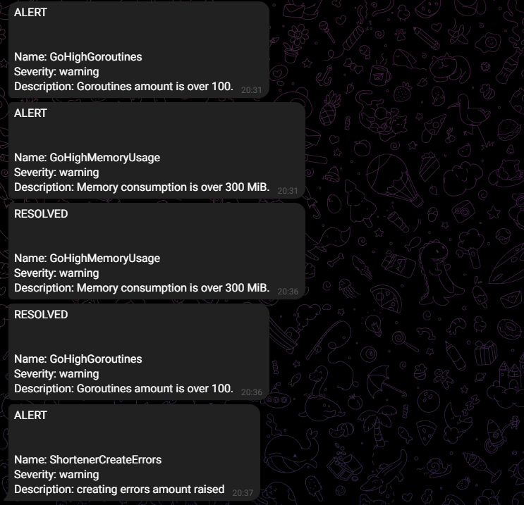

# Aлёрты для URL Shortener

## 1. Описание приложения и технологического стека

В проекте реализован сервис сокращения URL (URL Shortener).

Используемые технологии:

- **Go** — язык программирования приложения.
- **PostgreSQL** — реляционная база данных.
- **Docker** — контейнеризация приложения.
- **Kubernetes (Minikube)** — оркестрация и запуск приложения.
- **Helm** — установка и настройка VictoriaMetrics.
- **VictoriaMetrics Single** — сбор, хранение и анализ метрик.
- **Prometheus client_golang** — экспорт метрик Go-приложения.
- **PostgreSQL Exporter** — экспорт метрик PostgreSQL.

## 2. Какие метрики были выбраны для алертов

В качестве двух бизнес метрик были выбраны **url_shortener_probe_success** (проверка доступности сервиса) и   
**short_link_create_errors_total** (количество операций создания ссылок, завершившихся с ошибкой).   
Выбраны были потому что для сервиса критична **доступность** и **наличие главного функционала** - создания ссылок.   
В конфигурации был использован секрет kubernetes к ключом бота, в архив не был приложен.

## 3. Скриншот срабатывания алертов
