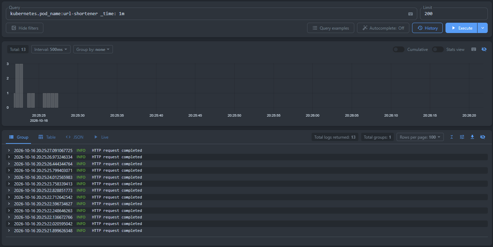
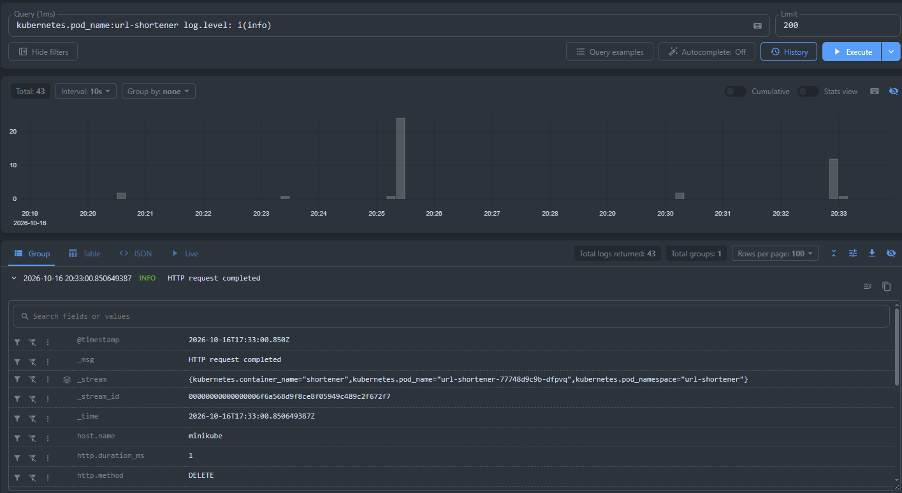
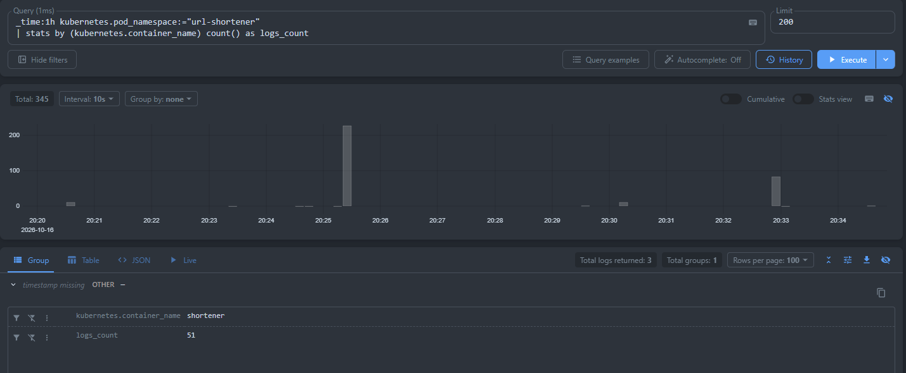
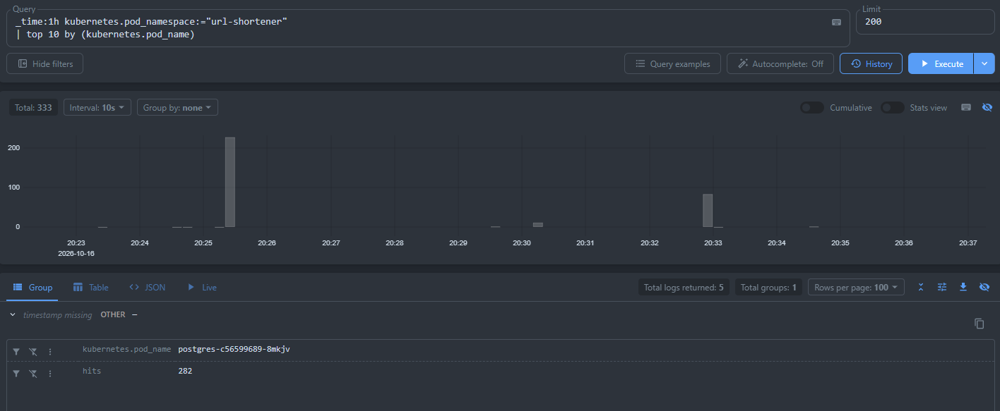

# Отчёт по LogsQL в VictoriaLogs

> **Окружение:** Minikube, namespace `url-shortener`, VictoriaLogs Single, VictoriaLogs Collector (`vlagent`).

## 1. Запрос A — сырые записи приложения за выбранный период

**LogsQL-запрос:**

```logsql
kubernetes.pod_name:=url-shortener _time: 1m
```

**Что показывает:** записи из пода `url-shortener` за 1 минуту.
Такой формат запроса был выбран из-за наличия большого количества логов minikube. В целом это базовая проверка, что логи нужного пода поступают в VictoriaLogs.

**Скриншот vmui:**



## 2. Запрос B — фильтрация по полю уровня логирования

**LogsQL-запрос:**

```logsql
kubernetes.pod_name:=url-shortener log.level:i(info)
```

**Что показывает:** записи, у которых поле `level` имеет значение `info`.
Запрос демонстрирует фильтрацию по конкретному полю, а не только поиск слова внутри текста сообщения.

**Скриншот vmui:**



## 3. Запрос C — подсчёт записей с группировкой по контейнеру

**LogsQL-запрос:**

```logsql
_time:1h kubernetes.pod_namespace:="url-shortener"
| stats by (kubernetes.container_name) count() as logs_count
```

**Что показывает:** группирует записи по имени контейнера и считает количество логов в каждой группе за период 1 час.

Такой запрос был выбран потому что `stats by (...)` демонстрирует группировку, а `count()` - подсчёт записей. Запрос помогает сравнить активность контейнеров.

**Скриншот vmui:**



## 4. Запрос D — топ pod по количеству записей

**LogsQL-запрос:**

```logsql
_time: 1h kubernetes.pod_namespace:="url-shortener"
| top 10 by (kubernetes.pod_name)
```

**Что показывает:** до 10 наиболее часто встречающихся значений `kubernetes.pod_name` в выбранном диапазоне 1 час, ранжированных по количеству записей.

Был выбран потому что`top` это агрегирующий запрос, который помогает определить, от каких pod поступает больше всего логов.

**Скриншот vmui:**



## 5. Почему выбран сбор логов через VictoriaLogs Collector (`vlagent`)

Логи приложения записываются в `stdout`/`stderr`. VictoriaLogs Collector собирает логи pod Kubernetes и отправляет их в VictoriaLogs Single по внутреннему адресу сервиса Kubernetes.

Этот способ выбран в первую очередь из-за упрощенной интеграции: Victoria Logs Collector легко интегрируется с Victoria Logs.

В данной конфигурации Collector отправляет записи в VictoriaLogs Single через endpoint `/insert/native`. vmui доступен по адресу `http://localhost:9428/vmui/` после проброса порта:

```text
kubectl port-forward -n logging svc/victoria-logs-single-server 9428:9428
```


# Helm Values

Для интеграции Victoria Logs были использованы:

**collector.yaml:**
```

remoteWrite:
  - url: http://victoria-logs-single-server.logging.svc.cluster.local:9428/insert/native
    headers:
      VL-Ignore-Fields:
        - kubernetes.container_id
        - kubernetes.pod_ip
        - kubernetes.pod_labels.pod-template-hash

collector:
  msgField:
    - message
    - msg
```


**Helm команды:**

```helm upgrade --install victoria-logs-collector oci://ghcr.io/victoriametrics/helm-charts/victoria-logs-collector --namespace logging --wait --timeout 15m -f .\k8s\collector.yaml```

```helm upgrade --install victoria-logs-single vm/victoria-logs-single --namespace logging --create-namespace --wait --timeout 15m --set server.retentionPeriod=30d --set server.persistentVolume.size=5Gi```